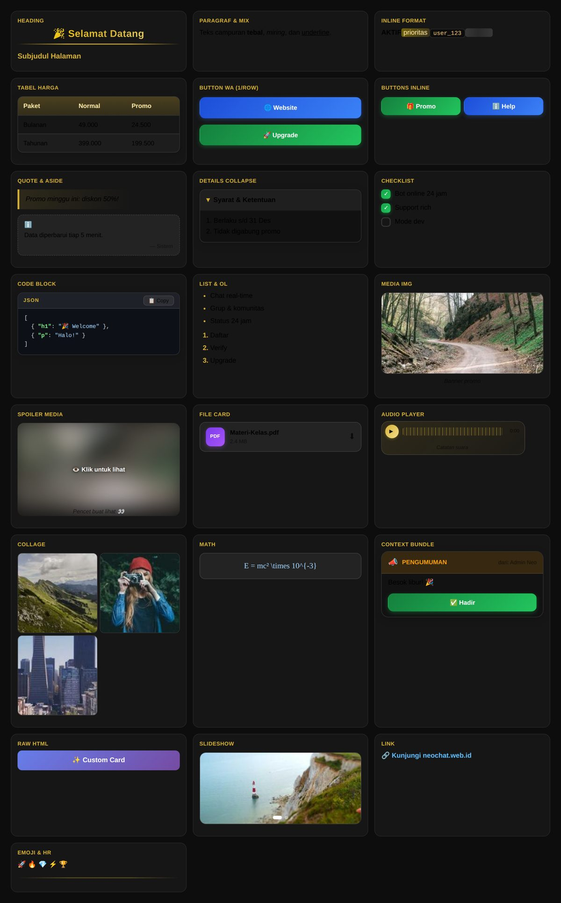

<div align="center">

&nbsp;
&nbsp;


# 🤖 NEOBOT-BYDIKA

### Bot Client Resmi untuk [NEO CHAT](https://neochat.web.id)

**Kirim Rich Message kaya Telegram & WhatsApp langsung dari terminal.**
Pairing kode 8 digit — semudah login WhatsApp Web. **100% gratis.**

[Website](https://neochat.web.id) · [Daftar Gratis](https://neochat.web.id) · [Contoh Template](EXAMPLE.md) · [Lapor Bug](https://github.com/dikadev-hub/neobot-bydika/issues)

</div>



<p align="center"><i>👆 Semua komponen Rich Message yang bisa bot kamu kirim — 22 showcase asli dari renderer Neo Chat.</i></p>

---

> **Neo Chat** adalah platform chat modern tanpa nomor HP — chat real-time, grup, komunitas, saluran, status 24 jam, dompo digital & **Rich Message engine** kaya Telegram. Daftar gratis di **[neochat.web.id](https://neochat.web.id)** 🚀

## 🎯 Kenapa NEOBOT?

| | |
|:---:|:---|
| 🔗 | **Pairing Kode 8 Digit** — generate dari Profile → Perangkat, masukkan ke bot, langsung konek |
| 🎨 | **24 Rich Keys** — heading, tabel, checkbox, spoiler, dokumen, audio, slideshow, math, dll |
| 🔘 | **Button Interaktif** — callback & URL button, button list kaya WhatsApp, carousel produk |
| 💬 | **Chat Pribadi & Grup** — bot balas & broadcast ke mana aja |
| 📦 | **Kirim Dokumen** — file card kaya WhatsApp (PDF, ZIP, dll) |
| 🔁 | **Auto-Reconnect** — internet putus? bot nyambung sendiri begitu balik |
| 🖥️ | **Terminal REPL** — monitoring & kontrol bot langsung dari terminal |

## 📊 Template Rich Message

<details open>
<summary><b>Klik untuk lihat semua 24 key</b></summary>

| Kategori | Key |
|---|---|
| **Teks** | `h1` – `h6` · `p` · `mix` · inline: `b` `i` `u` `s` `mark` `spoiler` `code` `sub` `sup` |
| **Struktur** | `blockquote` · `aside` · `details` · `hr` · `ul` · `ol` · `checkbox` · `table` |
| **Media** | `img` · `video` · `audio` · `figure` · `collage` · `slideshow` · `mediaSpoiler` · `file` |
| **Interaksi** | `a` · `buttons` · `buttonsInline` · `contextBundle` · button list · carousel |
| **Kode & Lain** | `pre` (+syntax highlight) · `math` · `mathBlock` · `emoji` · `raw` (HTML custom) · `footer` |

</details>

### Contoh: Menu Bot dengan Button

```js
sendRich(from, [
  { h1: "🤖 BOT KAMU" },
  { p: ["Halo ", { b: "kakak" }, "! Pilih menu 👇"] },
  { checkbox: [
    { checked: true,  text: "Bot online 24 jam" },
    { checked: false, text: "Mode premium" }
  ]},
  { buttonsInline: [[
    { text: "🎁 Promo", callback: "promo", style: "success"  },
    { text: "ℹ️ Help",  callback: "help",  style: "primary"  }
  ]]},
  { footer: "NeoBot • by dika" }
])
```

> 📚 Contoh lengkap lainnya: **[EXAMPLE.md](EXAMPLE.md)** — promo, katalog carousel, pesan gabungan ala WA, dokumen & media.

## 🚀 Cara Pakai

### 1️⃣ Daftar & Ambil Kode Pairing

Buka **[neochat.web.id](https://neochat.web.id)** → daftar gratis → **Profile** → **Perangkat & Bot** → **Generate Kode 8 Digit**

```
Kode berlaku 5 menit:  contoh →  ABCD-1234
```

### 2️⃣ Install & Jalankan

```bash
git clone https://github.com/dikadev-hub/neobot-bydika.git
cd neobot-bydika
npm install
node index.js ABCD-1234
```

<details>
<summary><b>⚙️ Konfigurasi lanjutan (environment)</b></summary>

```bash
NEO_SERVER=https://neochat.web.id   # server Neo Chat (default)
NEO_CODE=ABCD-1234                  # kode pairing
node index.js
```
Atau bikin file `.env` dari [.env.example](.env.example).

</details>

### 3️⃣ Bot Online! 🎉

DM bot kamu di Neo Chat:

| Command | Fungsi |
|---|---|
| `/menu` | Menu utama rich + button |
| `/promo` | Halaman promo (tabel harga + CTA) |
| `/catalog` | Katalog carousel produk |
| `/list` | Button list interactive kaya WA |
| `/html` | Rich HTML custom card |
| `/ping` | Cek bot hidup |
| `/grupinfo` | Info grup (kirim di grup) |
| `/announce <teks>` | Pengumuman grup rich |
| `/help` | Daftar perintah lengkap |

Terminal REPL: `status` = cek koneksi · `exit` = keluar.

## 🛠️ Bikin Command Sendiri

Buka `index.js`, tambah di bagian handler:

```js
if (text === "/halo") {
  return sendRich(from, [
    { h2: "👋 Halo juga!" },
    { p: ["Kamu ketik ", { code: "/halo" }, " — bot balas rich message."] },
    { buttonsInline: [[
      { text: "✨ Keren", callback: "menu", style: "success" }
    ]]}
  ])
}
```

Format rich-nya **sama persis** dengan yang tampil di web Neo Chat — tulis JSON, user lihat tampilan cantiknya. 🎨

## ❓ FAQ

<details>
<summary><b>Bayar?</b></summary>
<br>Gratis 100%. Bot-nya open source (MIT), web Neo Chat juga gratis dipake.
</details>

<details>
<summary><b>Bot mati pas internet putus?</b></summary>
<br>Auto-reconnect — begitu koneksi balik, bot langsung online lagi.
</details>

<details>
<summary><b>Kode 8 digit kedaluwarsa?</b></summary>
<br>Generate lagi dari Profile → Perangkat. Kode cuma berlaku 5 menit demi keamanan.
</details>

<details>
<summary><b>Bisa 1 akun banyak bot?</b></summary>
<br>Bisa! Tiap perangkat/bot dapet kode & sesi sendiri.
</details>

## 📄 Lisensi

Distributed under the **MIT License**. See [`LICENSE`](LICENSE) for more information.

---

<div align="center">

**Dibuat dengan ❤️ oleh [dika x dev](https://neochat.web.id)**

⭐ Star repo ini kalau bermanfaat!

</div>
